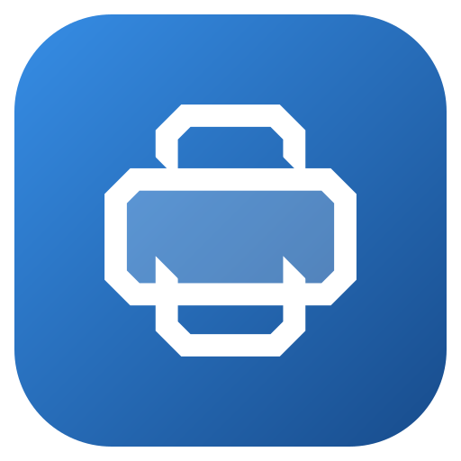
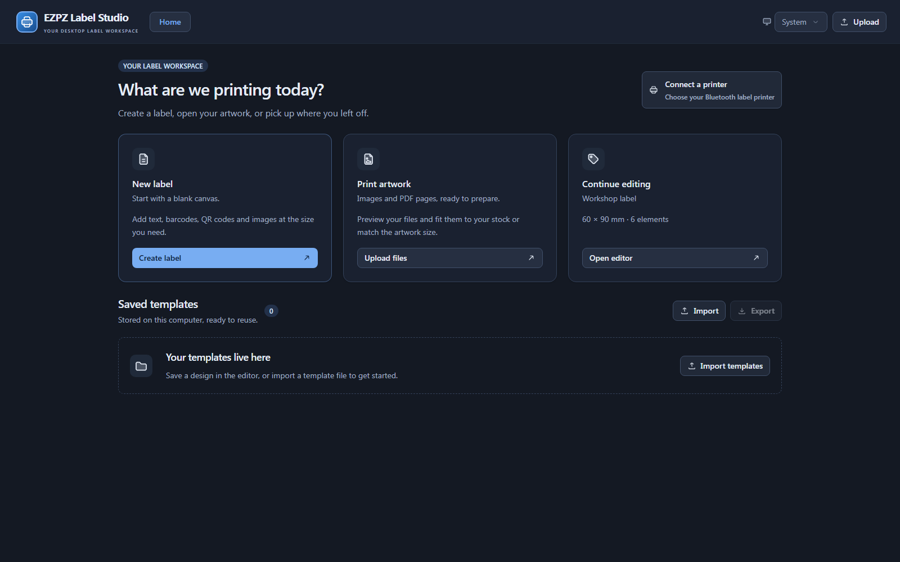
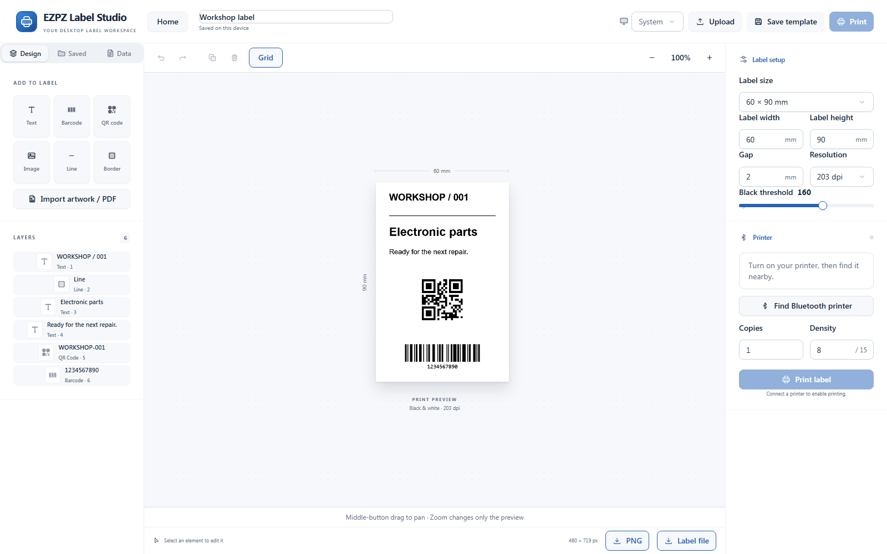

<div align="center">
  
  <h1>EZPZ Label Studio</h1>
  <p><strong>Your labels. Your printer. Your workspace.</strong></p>
  <p>Design thermal labels, prepare PDF artwork and print over Bluetooth.<br>Native Windows app and shared web editor. No application account required.</p>
  <p><a href="https://tapuz97.github.io/EZPZ-Label-Studio/">Open the web app</a> · <a href="https://github.com/Tapuz97/EZPZ-Label-Studio/releases/latest">Windows downloads</a> · <a href="docs/microsoft-store.md">Microsoft Store guide</a> · <a href="mailto:gm@galmitrani.com">Support &amp; commercial licensing</a></p>
  <p>Windows · Bluetooth LE · PDF &amp; images · Barcodes &amp; QR · Local processing</p>
</div>



## From artwork to label

Start with a blank label, import a file, or reuse a template. Preview the final
monochrome print, adjust the stock and artwork, then send it to your printer.
The Windows app bundles its assets locally and runs without an internet
connection. The web edition loads from GitHub Pages and processes your artwork
on your own device.

| Design | Prepare | Print & reuse |
| --- | --- | --- |
| Text, images, lines and borders | PDF page selection and immediate previews | Supported BLE printer selection |
| Barcodes and QR codes | Automatic Vertical/Horizontal orientation | Progress and cancellation |
| Drag, resize and rotate | Stock presets, custom sizes, margins and scale | Local templates and JSON bundles |
| Undo/redo and layer controls | Zoom and middle-button panning | PNG export and CSV-driven labels |

Assign a **Component ID** to text, QR and barcode elements to bind them to CSV
columns. In Data, export a sample CSV, fill its rows, then import it and choose
batch printing. Blank IDs keep fixed content; existing `{{column}}` placeholders
also work. Required columns are validated before sending any labels.

Resize text proportionally, set RTL/LTR and text alignment, and align components
to the label or another component. Drag the rotation handle (Snap uses 15-degree steps); snapping shows alignment guides, with Alt to bypass. Image properties
include a visual crop editor with eight handles. QR properties include background and embedded center
logo options; barcode numbers and line/border thickness are configurable.

Light, Dark and System appearance are included. Icons and PDF resources are
bundled locally; the application does not fetch icon fonts or artwork from a CDN.



## Printer compatibility

**Designed to work with most Bluetooth LE printers compatible with the EZlabel
app, but further testing is required across models.** This is the intended
compatibility range, not a claim that every such printer works. EZPZ is an
independent project, unaffiliated with the reference app or printer manufacturers.

| Printer / family | Current evidence |
| --- | --- |
| **BPXX DB403** | Windows and Chrome/Windows 11 connection and physical 60 × 90 mm, 203 DPI printing verified; output confirmed by the owner |
| Other EZlabel-compatible BLE printers | Supported service/profile and format paths implemented; each model still needs physical testing |
| Web Bluetooth printing | DB403 physically verified on Chrome / Windows 11; other browser/printer combinations need testing |
| Niimbot, iPrint, Labelife, Nelko, Jadens, Pixmate, and other families | Future research candidates; **not currently claimed as supported** |

A Bluetooth name or connection does not prove print compatibility. A printer
needs a supported BLE service and print format. Classic Bluetooth SPP/RFCOMM
is not implemented. DPI, print width and loaded stock are not invented when the
printer does not report them; choose the settings for your printer and roll.
Future support will use captured communication, documented profiles and physical
test prints. Shared protocols across brands remain a possibility to verify.

## Start printing

1. **Open Windows or [the web app](https://tapuz97.github.io/EZPZ-Label-Studio/).**
   Windows builds are in [Releases](https://github.com/Tapuz97/EZPZ-Label-Studio/releases)
   for repository collaborators. Microsoft Store publication is in preparation.
   The reserved Store product is **9PNR3K65GQFL** (publisher **Engineer101**).
2. **Create a label or choose Print artwork.** Upload PDF, PNG, JPEG, WebP, BMP
   or GIF (first frame). Try the [sample template bundle](examples/templates/sample-templates.json)
   using Home → Saved templates → Import.
3. **Choose the loaded stock size.** Select a preset or custom dimensions. Fit
   without stretching, or match the label to the artwork. Orientation follows
   the uploaded file and can be changed manually.
4. **Review the monochrome preview.** Resize artwork using its handles or
   dimensions. Set scale/margins during import. Zoom affects only the view;
   hold the middle mouse button and drag to pan.
5. **Connect and print.** Turn on the printer, disconnect it from your phone,
   choose Connect a printer and select it. Start with one label and check the
   physical result before running a batch.

### Windows and web

| | Windows | Web |
| --- | --- | --- |
| Editor, uploads and templates | Yes | Yes |
| Bluetooth selection | Native Windows scan | Browser-controlled device picker |
| Printing | Native BLE | Experimental Web Bluetooth on supported Chrome/Edge devices over HTTPS |
| Unsupported browsers | — | Editing/export remain available; use Windows for Bluetooth |
| Template storage | Installation `templates` directory, with persistent user-data fallback | This website's browser storage |
| Internet | Not required after installation | Required to load the hosted app; no offline web-install guarantee |

Saved Windows templates are stored in `templates/library.json` beside the application
when that directory is writable. Protected installations use the application's
persistent user-data `templates` directory instead. The Home and Saved panels show
the actual directory. Existing Windows app-profile templates migrate on first use;
exports remain portable JSON files. Select multiple JSON files or bundles to import
them together; the entire selection is validated before saving.

The web edition needs permission after your click. It uses a browser-reported
payload limit when available. For DB403 on its verified service, a non-printing
model inquiry checks whether a complete 244-byte packet arrives; otherwise it
keeps 20-byte chunks. Safari and Firefox are not Bluetooth-printing targets. See
[browser/security limitations](https://developer.mozilla.org/en-US/docs/Web/API/Web_Bluetooth_API).
Windows and browser templates are separate; export/import JSON to move designs.

## Privacy and practical limits

PDF/image/CSV processing is local. No application account, advertising, analytics
or document-upload service is used. GitHub Pages handles ordinary website
requests under its privacy terms. Read the [privacy policy](https://tapuz97.github.io/EZPZ-Label-Studio/privacy.html).

“Sent” means Bluetooth writes completed, not that a sensor confirmed paper
output. Failed transfers are never automatically retried. Cancel stops remaining
writes; buffered data may still print. After an interrupted bitmap transfer,
power-cycle the printer before retrying.

Artwork limits: 30 MB per file, 50 prepared pages/images, 40 million decoded
pixels per preparation, 8 million pixels per print raster, 1 MB per encoded
transfer and 100 labels including copies per batch. Paper/head limits apply.
Camera/OCR, firmware updates and automatic stock calibration are not implemented.

## Develop and build

Node.js 24 is used in CI. Windows development additionally needs Rust MSVC,
Visual Studio C++ Build Tools and WebView2.

```sh
npm ci
npm run dev          # browser development at http://127.0.0.1:1420
npm run build:web    # GitHub Pages output in dist-web/
npm test
```

```powershell
npm run tauri -- dev
npm run tauri -- build --bundles nsis
node scripts/collect-windows-build.mjs
cargo test --release --manifest-path src-tauri/Cargo.toml --lib
```

The collector places the portable EXE, offline installer and checksum receipt in
`output/windows`. The installer includes offline WebView2; the portable uses the
runtime already on Windows. Packaged apps need no Node, Rust or development server.

The Pages workflow tests and deploys `main` to
<https://tapuz97.github.io/EZPZ-Label-Studio/>. `VITE_BASE_PATH` controls web asset
paths (default `/EZPZ-Label-Studio/`). The source repo is private; the published
website is public. Compiled browser code and static assets are downloadable by
visitors, so no secrets belong in them.

| Source | Responsibility |
| --- | --- |
| `src/` | Shared React editor, import/rendering and browser printer support |
| `src-tauri/src/` | Windows BLE, capabilities, raster encoding and shutdown |
| `public/` | Offline PDF assets, app icon, public support/privacy pages |
| `examples/templates/` | Editable sample template bundle |
| `scripts/` | Asset generation, build collection, web and Store packaging |
| `docs/` | Verification, cleanup history and Store submission guide |

Reference APKs and private investigation captures are outside this repository.
Diagnostic tools live in `src-tauri/examples/`; `print_probe` never prints unless
its explicit `--print` option is supplied. See the [Store guide](docs/microsoft-store.md),
[verification records](docs/frontend-testing.md) and [cleanup report](docs/project-cleanup.md).

## Licence, attribution and commercial use

**Copyright © 2026 Gal Mitrani.** Original project code uses
[PolyForm Noncommercial 1.0.0](LICENSE). Retain the attribution in [NOTICE](NOTICE)
when distributing the software or work based on it. Noncommercial forks are
allowed; contributing improvements to the original project is encouraged.

Commercial use outside the licence's permitted purposes requires a **separate
paid written agreement** with Gal Mitrani. Contact **[gm@galmitrani.com](mailto:gm@galmitrani.com)**.
See [COMMERCIAL.md](COMMERCIAL.md) for scope and contribution/relicensing notes.
This is source-available software, not Apache-licensed or OSI open source.
Third-party libraries and theSVG icons retain their own licences in
[THIRD_PARTY_NOTICES.txt](THIRD_PARTY_NOTICES.txt).
