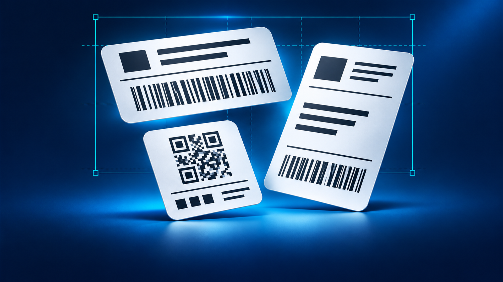
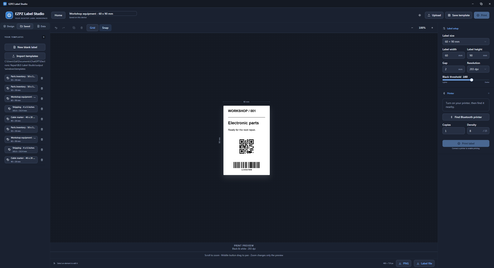
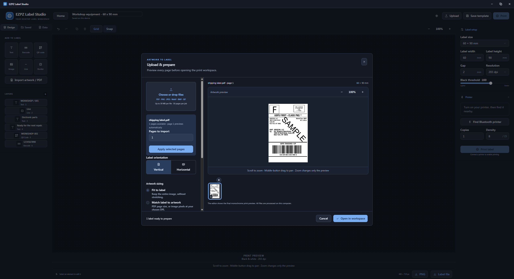

<div align="center">
  
  <h1>EZPZ Label Studio</h1>
  <p><strong>Design. Prepare. Print.</strong></p>
  <p>A desktop workspace for your Bluetooth label printer.<br>Create a design, prepare your artwork, or turn a CSV into a batch of labels.</p>
  <p><a href="https://apps.microsoft.com/detail/9PNR3K65GQFL"></a></p>
  <p><a href="https://tapuz97.github.io/EZPZ-Label-Studio/"><strong>Open the web editor</strong></a> &nbsp; · &nbsp; <a href="https://github.com/Tapuz97/EZPZ-Label-Studio/releases/latest">Windows downloads</a> &nbsp; · &nbsp; <a href="examples/templates/sample-templates.json">Sample templates</a></p>
  <p>Native Windows app &nbsp; · &nbsp; Shared web editor &nbsp; · &nbsp; Local file processing</p>
</div>

<p align="center">
  
</p>

<p align="center"><a href="#start-printing">Get started</a> &nbsp; · &nbsp; <a href="#inside-the-studio">Screenshots</a> &nbsp; · &nbsp; <a href="#printer-compatibility">Printer compatibility</a> &nbsp; · &nbsp; <a href="#develop-and-build">Development</a> &nbsp; · &nbsp; <a href="#licence-and-support">Licence &amp; support</a></p>

## A small studio for everyday labels

Parts bins, equipment tags, parcel artwork, and repeat jobs. Start with a blank
canvas, upload a file, or pick up a saved template. Review the monochrome output
before sending it to your printer.

| Design your label | Prepare your artwork | Print and reuse |
| --- | --- | --- |
| Text, images, barcodes, and QR codes | PDF pages and common image formats | Compatible Bluetooth LE printers |
| Alignment, rotation, and grid snapping | Visual cropping, scaling, and orientation | CSV batches with named component fields |
| RTL/LTR text and text alignment | Stock presets and custom dimensions | Local templates, bulk import, and export |
| QR backgrounds and center logos | Zoom, pan, and monochrome previews | Copies, print progress, and cancellation |

**Your files stay local.** PDF, image, and CSV processing happens on your device.
The Windows editor bundles its assets and works without an internet connection
following installation. No application account is required. Appearance follows
your system until you choose Light or Dark with the sun/moon button.

## Inside the studio

<table>
  <tr>
    <td width="50%" align="center">
      <a href="docs/images/editor-dark.png"></a>
      <p><strong>Build your layout</strong><br>Arrange components and inspect the final print preview.</p>
    </td>
    <td width="50%" align="center">
      <a href="docs/images/artwork-upload.png"></a>
      <p><strong>Bring your artwork</strong><br>Prepare PDF pages and images before opening the workspace.</p>
    </td>
  </tr>
</table>

<p align="center"><sub>Click a screenshot to view it at full size.</sub></p>

## Start printing

1. **Choose your workspace.** Use the [Microsoft Store app](https://apps.microsoft.com/detail/9PNR3K65GQFL), a [Windows installer or standalone EXE](https://github.com/Tapuz97/EZPZ-Label-Studio/releases/latest), or the [web editor](https://tapuz97.github.io/EZPZ-Label-Studio/).
2. **Create or import.** Start a label, upload a PDF or image, or import the [sample template bundle](examples/templates/sample-templates.json) from Home → Saved templates → Import.
3. **Set your stock.** Choose the size loaded in your printer. Fit artwork without stretching, or match the label to the artwork. Adjust orientation, scale, and margins as needed.
4. **Check the preview.** Scroll to zoom and hold the middle mouse button to pan. Zoom changes your view; use the component handles or dimensions to change the printed size.
5. **Connect and print.** Turn on your printer, disconnect it from your phone, then choose Connect a printer. Check one physical label before running a batch.

### One template, many labels

Give text, QR, or barcode components a **Component ID** matching a CSV column.
For example, `name` can populate a text component while `item` populates a barcode.
Export a sample CSV from Data, fill in the rows, import it, and choose batch printing.

Blank IDs keep fixed content. Existing `{{column}}` placeholders also work, and
required columns are validated before any labels are sent.

<details>
<summary><strong>Editor controls and artwork options</strong></summary>

- Resize text proportionally and set its direction and alignment.
- Align components to the label or one another. Drag a rotation handle to rotate;
  Snap uses 15-degree steps. Snapping shows alignment guides; hold Alt to bypass it.
- Crop images with corner and side handles. Corners preserve proportions by
  default; hold Shift to adjust them freely.
- Show or hide QR backgrounds and uploaded center logos, toggle barcode numbers,
  and adjust line and border thickness.
- Import PDF, PNG, JPEG, WebP, BMP, or GIF (first frame). Export designs as PNG or
  reusable label files.

</details>

## Printer compatibility

**Designed to work with most Bluetooth LE printers compatible with the EZlabel
app, with further testing required across models.** EZPZ is an independent
project, unaffiliated with the reference app or printer manufacturers.

| Printer or family | Current evidence |
| --- | --- |
| **BPXX DB403** | Physical 60 × 90 mm, 203 DPI printing verified on Windows and Chrome / Windows 11; output confirmed by the owner |
| Other EZlabel-compatible BLE printers | Service/profile and print-format paths implemented; each model still needs physical testing |
| Niimbot, iPrint, Labelife, Nelko, Jadens, Pixmate, and other families | Future research candidates; **not currently claimed as supported** |

A Bluetooth name or successful connection does not prove print compatibility.
Classic Bluetooth SPP/RFCOMM is not implemented. When a printer does not report
its DPI, print width, or loaded stock, choose the correct settings manually.

## Windows and web

| | Windows app | Web editor |
| --- | --- | --- |
| Design, uploads, and templates | Included | Included |
| Printer selection | Native Windows scan | Browser-controlled device picker |
| Bluetooth printing | Native BLE | Experimental Web Bluetooth on supported Chrome/Edge devices over HTTPS |
| Template storage | Writable application `templates` directory, with persistent user-data fallback | This website's browser storage |
| Internet access | Not required after installation | Required to load the hosted app; offline installation is not guaranteed |

The Windows app requires Microsoft Edge WebView2 Runtime. The EXE installer
includes the offline runtime installer; the standalone app uses the runtime
already on Windows. Bluetooth printing needs a compatible BLE printer and
Windows Bluetooth support.

Browser support varies. DB403 printing has been physically verified in Chrome on
Windows 11. Safari and Firefox are not Bluetooth-printing targets; editing and
export remain available. See [Web Bluetooth browser support](https://developer.mozilla.org/en-US/docs/Web/API/Web_Bluetooth_API).

<details>
<summary><strong>Template storage and moving designs between platforms</strong></summary>

Windows saves templates in `templates/library.json` beside the application when
that directory is writable. Protected installations use the application's
persistent user-data `templates` directory instead. Home and Saved show the
actual location. Existing Windows app-profile templates migrate on first use.

Select multiple JSON files or bundles to import them together; the entire
selection is validated before saving. Windows and browser libraries are
separate. Use template export/import to move designs between them or back them up.

</details>

<details>
<summary><strong>Local processing, transfer behavior, and practical limits</strong></summary>

No application account, advertising, analytics, or document-upload service is
used. Icons and PDF resources are bundled locally. GitHub Pages handles ordinary
website requests under its own privacy terms. Read the [privacy policy](https://tapuz97.github.io/EZPZ-Label-Studio/privacy.html).

“Sent” means Bluetooth writes completed, not that a sensor confirmed paper
output. Failed transfers are never automatically retried. Cancel stops remaining
writes; buffered data may still print. After an interrupted bitmap transfer,
power-cycle the printer before retrying.

The browser uses its reported payload limit when available. For DB403 on its
verified service, a non-printing model inquiry checks whether a complete
244-byte packet arrives; otherwise it keeps 20-byte chunks. Future printer
support will use captured communication, documented profiles, and physical tests.

Artwork limits: 30 MB per file, 50 prepared pages/images, 40 million decoded pixels
per preparation, 8 million pixels per print raster, 1 MB per encoded transfer,
and 100 labels including copies per batch. Paper and print-head limits also apply.
Camera/OCR, firmware updates, and automatic stock calibration are not implemented.

</details>

## Develop and build

<details>
<summary><strong>Run locally, build Windows, and find your way around the source</strong></summary>

Node.js 24 is used in CI. Windows development additionally needs Rust MSVC,
Visual Studio C++ Build Tools, and WebView2.

```sh
npm ci
npm run dev          # Browser development at http://127.0.0.1:1420
npm run build:web    # GitHub Pages output in dist-web/
npm test
```

```powershell
npm run tauri -- dev
npm run tauri -- build --bundles nsis
node scripts/collect-windows-build.mjs
cargo test --release --manifest-path src-tauri/Cargo.toml --lib
```

The collector places the standalone EXE, offline installer, and checksum receipt
in `output/windows`. Packaged apps need no Node, Rust, or development server.

The Pages workflow tests and deploys `main` to the [web editor](https://tapuz97.github.io/EZPZ-Label-Studio/).
`VITE_BASE_PATH` controls web asset paths (default `/EZPZ-Label-Studio/`). Published
browser code and static assets are downloadable, so no secrets belong in them.

| Source | Responsibility |
| --- | --- |
| `src/` | Shared React editor, import/rendering, and browser printer support |
| `src-tauri/src/` | Windows BLE, capabilities, raster encoding, and shutdown |
| `public/` | Offline PDF assets, app icon, public support/privacy pages |
| `examples/templates/` | Editable sample template bundle |
| `brandkit/` | [App icons, promotional artwork, and Store badge](brandkit/README.md) |
| `scripts/` | Asset generation, build collection, web and Store packaging |
| `docs/` | Developer verification and cleanup records |

Reference APKs and private investigation captures are outside this repository.
Diagnostic tools live in `src-tauri/examples/`; `print_probe` never prints unless
its explicit `--print` option is supplied. See the [verification records](docs/frontend-testing.md),
[transport notes](docs/transport-performance.md), and [cleanup report](docs/project-cleanup.md).

</details>

## Licence and support

**Copyright © 2026 Gal Mitrani.** Original project code is available under
[PolyForm Noncommercial 1.0.0](LICENSE). Retain the attribution in [NOTICE](NOTICE)
when distributing the software or works based on it. Noncommercial forks are
allowed; contributing improvements to this project is encouraged.

Commercial use outside the licence's permitted purposes requires a **separate
paid written agreement** with Gal Mitrani. See [commercial licensing](COMMERCIAL.md).
This is source-available software, not Apache-licensed or OSI open source.
Third-party libraries and artwork retain their own rights and licences; see
[third-party notices](THIRD_PARTY_NOTICES.txt) and the [brand kit](brandkit/README.md).

<p align="center">
  <a href="mailto:gm@galmitrani.com"><strong>Support &amp; commercial licensing</strong></a> &nbsp; · &nbsp;
  <a href="https://tapuz97.github.io/EZPZ-Label-Studio/privacy.html">Privacy</a> &nbsp; · &nbsp;
  <a href="brandkit/README.md">Brand kit</a>
</p>
